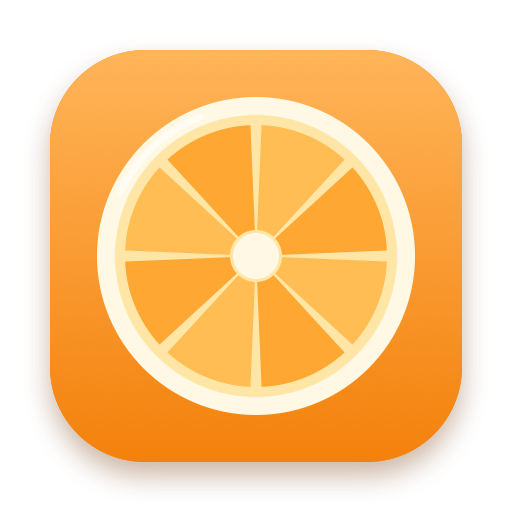

<p align="center">
  
</p>

<h1 align="center">Zest</h1>
<p align="center"><b>Convert and edit any file without leaving the drag.</b><br>
A free, open-source macOS menu-bar app: pick up a file, tap <kbd>Shift</kbd>, and drop it on a
wheel of actions that appears under your cursor.</p>

---

## What it does

Drag one or more files from Finder (or anywhere), tap **Shift**, and a glass wheel opens at
the cursor. Four orange segments, like the sections of an orange, are the top level:

| Segment | What is inside |
| --- | --- |
| **Convert** | Every format your Mac and the installed engines can produce from the selection |
| **Compress** | Images, video, audio to a target size; PDF compression is planned |
| **Edit** | Crop, annotate, redact and add backgrounds to images; trim, crop, redact video and bleep audio (in progress) |
| **Files** | Merge, split and create PDFs, image collages, strip metadata, audio to video |

Hold a file over a segment for about half a second to open it, hold the centre to go back,
and release over a leaf to run it. Output is a new copy saved beside the original; the
original is never modified.

- **Mixed selections.** Select a HEIC and a PNG, convert both to JPEG in one go.
- **Honest routing.** If a conversion cannot be done, Zest says why instead of hiding it.
- **Local and private.** No accounts, no network calls, no telemetry.
- **Native.** Swift, AppKit and SwiftUI with Liquid Glass on macOS 26 and materials before.

## Install

Runs on macOS 13 or later on Apple silicon (Liquid Glass on macOS 26). There is no signed release yet, so build it with Xcode 26+:

```sh
git clone https://github.com/CodeOfDuty007/ZEST--the-quick-file-conversion-app.git
cd ZEST--the-quick-file-conversion-app
make bootstrap && make install
```

On first launch grant **Accessibility** and **Input Monitoring** in System Settings, then
relaunch Zest. Zest opens at login by default; switch that off in its window.

## Reproducible builds

| Needed | Why | Install |
| --- | --- | --- |
| Xcode 26+ (Swift 6) | compiler and the macOS 26 SDK (Liquid Glass APIs; the app still runs on macOS 13+) | App Store |
| [XcodeGen](https://github.com/yonaskolb/XcodeGen) | generates `Zest.xcodeproj` from `project.yml` | `brew install xcodegen` |
| FFmpeg (optional) | video and audio conversion, compress | `brew install ffmpeg` |
| libwebp (optional) | WebP output | `brew install webp` |

`make bootstrap` installs all of it. The Xcode project is generated, not committed, so a
fresh clone needs nothing but those tools. `make test` builds the app and runs the unit tests
of every package; GitHub Actions does the same on each push.

## Repository layout

```
App/Zest/                 menu-bar app: wheel panel, drag detection, editors (AppKit + SwiftUI)
Packages/ZestCore/        engine with no UI: router, wheel tree, navigator, geometry, job pipeline
Packages/ZestBackends/    ImageIO, PDFKit, FFmpeg and WebP backends, image editing
Packages/ZestCLI/         `zest` command line front end to the same engine
docs/                     design notes and the manual test script
scripts/                  bootstrap, dev signing and icon generation
project.yml               XcodeGen definition of the app target
```

The engine is a capability graph: each backend declares what it can read and write, and the
router finds the best route (up to two hops, only through lossless intermediates) and
explains every rejection. Editors and tools are declared once as `ToolSpec`s and the wheel
tree is built from what applies to the current selection.

## Command line

```sh
cd Packages/ZestCLI && swift build -c release
.build/release/zest convert photo.heic --to jpg
.build/release/zest why clip.mov gif          # explains why a route is missing
.build/release/zest tools *.png               # every tool for these files
```

## Roadmap

Tracked for upcoming releases:

- [ ] Video and audio editors: trim, crop, redact, bleep
- [ ] Split and join video, compress PDF
- [ ] Run conversions in an XPC worker so a bad file can never crash the wheel
- [ ] Bundled static FFmpeg and libwebp (no Homebrew needed)
- [ ] Settings window, progress HUD and first-run onboarding
- [ ] Global hotkey and Finder Quick Action as alternatives to the drag gesture
- [ ] Documents, slides, spreadsheets, EPUB, subtitles and archives
- [ ] App Intents and Shortcuts support
- [ ] Notarised releases with Sparkle updates

Done: drag wheel with tree navigation, multi-file and mixed-type conversion, image / PDF
conversion, compress, metadata stripping, PDF merge and split, image collage, and the four
image editors.

## License

Zest is free software under the [GNU GPL v3 or later](LICENSE). Contributions welcome; see
[CONTRIBUTING.md](CONTRIBUTING.md).
